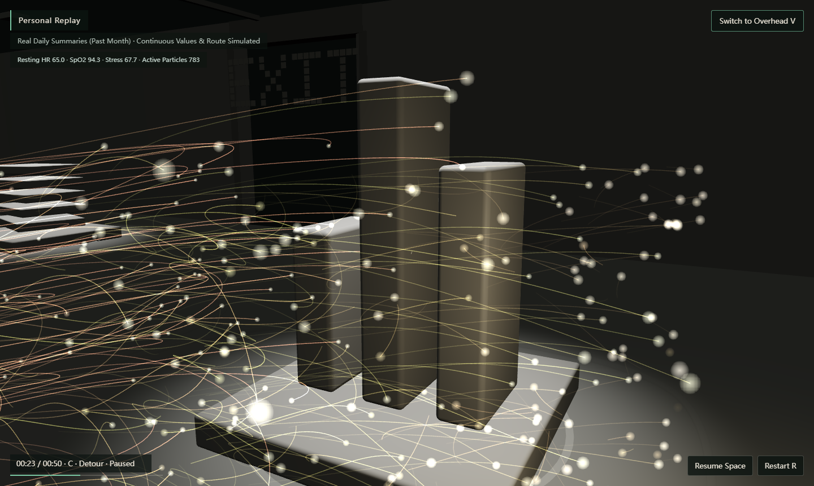
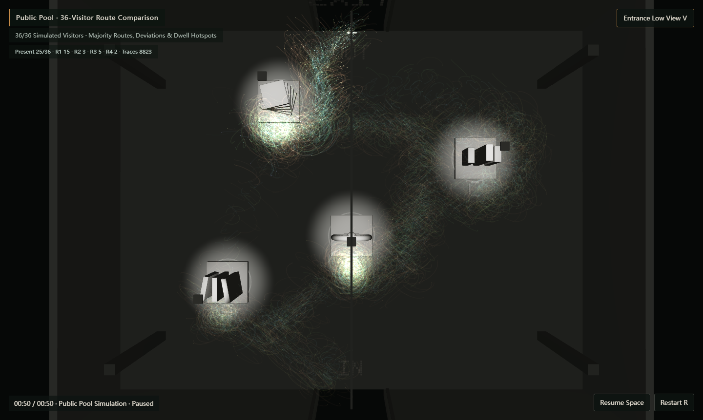
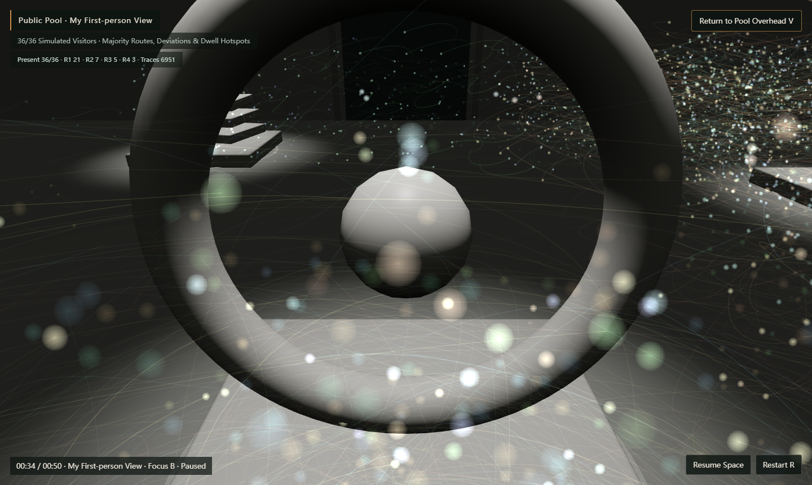
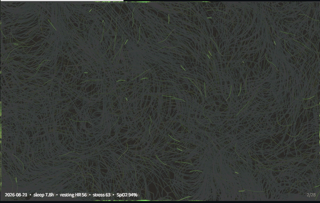
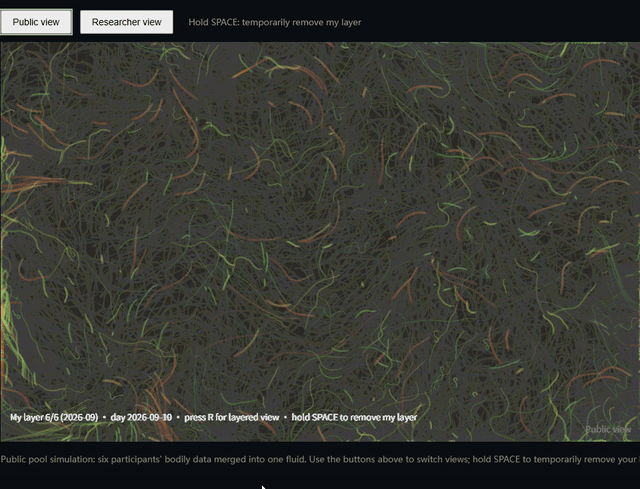

# Data-Viz Pilot

**Invited Imbrication / Public Pool** is the current portfolio presentation built on this pilot: an interactive 3D replay of body–space trajectories, an anonymised public pool, and a first-person data tide.

The repository also preserves the original two-mode visualisation instrument: **body data, painted as breathing fluid**, with a generative abstract view alongside conventional small-multiple charts and a built-in study flow (consent → pre-survey → viewing → post-survey).

参与者用自己的可穿戴数据，在“抽象生成流体／常规图表”两种可视化之间对照观看，问卷测量理解、信任、情绪与公共池出让意愿。原始试点支持中英双语；当前 3D 作品集演示使用英文界面。

## From visualisation to exhibition-space research

The 3D demo extends the original pilot rather than replacing it. The first version asked how wearable data could be abstracted, compared and potentially shared; **Invited Imbrication** moves those questions into a simulated exhibition space, asking how body data might be situated in movement, replayed as spatial experience and encountered collectively.

It is a **concept demonstration for future curatorial and exhibition-space research**, not a finished exhibition system. The prototype explores:

- how viewing order, dwell points and daily body summaries can form a replayable body–space trajectory;
- how individual trajectories change in meaning when they enter a shared public pool;
- how overhead comparison and first-person immersion frame collective norms, deviation and unnoticed self-adjustment differently.

A future exhibition scenario could combine consent-based optional sensing, personal replay, optional upload and anonymous feedback. The current demo uses existing daily summaries together with simulated routes, dwell schedules and other visitors; it does not collect new body data or implement public upload.

换言之，3D 版本是在原有“身体数据抽象—个人观看—公共池”想法上的空间化延伸：它把屏幕中的可视化比较转化为策展空间中的行走、停留、重演与集体对照，为未来展览研究提供可操作的概念原型。

## Quickstart

### 1. Original two-mode pilot

The app reads `viz/data/huawei_daily.csv`. Synthetic sample files are included, so a fresh clone only needs two copy steps:

```bash
cd viz
cp data/mock.csv data/huawei_daily.csv
cp data/mock.csv data/huawei_daily_full.csv   # needed for ?days=all and ?mode=pool
python -m http.server 8000
# open http://localhost:8000
```

Do not open `index.html` through `file://`; browsers block the required local data reads.

Useful URL parameters: `?lang=en` · `?mode=abstract|chart` · `?day=YYYY-MM-DD` · `?days=all` · `?mode=pool` · `?view=layers` · `?step=pre|viewing|post|done` (testing only). In the pool, **R** toggles public/layered view; holding **Space** temporarily removes “my” layer.

### 2. Current 3D portfolio demo

Requires Node.js 22.12 or later. The demo includes personal particle replay, a public pool with **35 simulated visitors plus my replay**, four route variants, overhead and first-person cameras, and a dark gallery with emissive traces.

```bash
cd public-pool-demo
cp src/body-data.example.js src/body-data.js   # fresh clone only; synthetic data
npm install
npm run dev
# open the local URL printed by the development server
```

If `src/body-data.js` already exists, **do not overwrite it**: the local file contains personal daily summaries and is gitignored. The example file uses synthetic values.

Controls:

- **Space**: pause / continue.
- **V**: change camera.
- **R**: restart replay.
- **M** in Public Pool: **Highlight Me → Remove Me → Restore Me**. Removal excludes my core, emissions, flow traces and path memory; it does not create a 37th identity.

Useful commands: `npm run check` validates the project; `npm run build` creates the gitignored `dist/` directory.

Route definitions and validation results are documented in `public-pool-demo/docs/pool-data.md`.

## Repository structure

```text
data-viz-pilot/
├── viz/                              # original two-mode p5.js instrument
│   ├── index.html                    # four-step study wizard
│   ├── sketch.js                     # particle fluid, charts and pool simulation
│   ├── app.js                        # wizard flow, i18n, session log, JSON export
│   ├── lib/                          # localised p5.js
│   └── data/
│       ├── mock.csv                  # synthetic sample data (tracked)
│       ├── huawei_daily.csv          # personal — local, gitignored
│       └── huawei_daily_full.csv     # personal — local, gitignored
├── public-pool-demo/                 # current 3D demo (Edit3D / Three.js)
│   ├── src/                          # scenes, routes, particles and English UI
│   │   ├── data/                     # simulated pool routes, visitors and aggregates
│   │   ├── body-data.example.js      # synthetic monthly-data template
│   │   └── body-data.js              # real monthly summaries — local, gitignored
│   ├── docs/                         # mapping, design decisions and checkpoints
│   ├── scripts/                      # pool-data generation and validation
│   ├── .edit3d/                      # runtime packages required by npm
│   └── data/                         # local editor state — gitignored
├── portfolio-concept/                # application narrative and presentation assets
│   ├── Public Pool_ Particle Replay of Body–Space Trajectories.pptx
│   ├── demo-development-workflow.md
│   ├── demo-video/                   # video masters, editing projects and production scripts
│   ├── screenshots/                  # development evidence and selected final views
│   └── media/                        # historical recordings and reference sheets
├── scripts/huawei_to_daily.py        # raw Huawei export → daily CSV
├── media/                            # recordings of the original pilot modes
├── consent/                          # consent form draft
├── questionnaire/                    # questionnaire draft
├── docs/                             # private research documents — gitignored
├── sessions/                         # participant exports — gitignored
├── working files/                    # client-managed document copies — gitignored
└── data/                             # full-archive daily CSV — gitignored
```

## Inside the 3D pilot

Built with Three.js and Edit3D, **Invited Imbrication** translates the original screen-based visualisation into a simulated gallery. A dark, minimal architectural setting, white works and localised spotlights keep attention on the luminous body–space traces. The demo is a research proposition: it tests how abstraction, spatial replay and collective comparison might make unnoticed behavioural adjustment and self-discipline perceptible.

### Personal replay — body data as a spatial trace



Thirty days of existing daily summaries are interpolated into a continuous replay. Resting heart rate, SpO2 and stress modulate the particle emission, colour and flow around a single moving core, while the gallery route and dwell schedule are simulated. The result is not a literal reconstruction of measured movement, but a way to examine how body data could be experienced as duration, rhythm and spatial presence.

### Public pool — collective routes, repetition and deviation



The public pool brings together **35 simulated visitors and my replay** across four route variants. The overhead view exposes majority paths, dwell hotspots and departures from shared patterns. The **Highlight Me → Remove Me → Restore Me** interaction tests how an individual trajectory becomes visible, disappears or remains implicitly present within a collective dataset.

### First-person view — inside the data tide



The first-person camera places the viewer with their own moving core inside the collective particle flow. Where the overhead camera supports comparison and analysis, this view prioritises immersion: the public pool is encountered as a surrounding field of other bodies and trajectories rather than only as an external map.

## Data format and simulation boundary

```text
date,resting_hr,sleep_min,spo2,stress,sleep_capped
```

Daily granularity; `sleep_capped=1` marks days truncated at 960 min (bad-merge / extreme-day guard). To use different records, shape daily summaries to this schema and place them in `viz/data/huawei_daily.csv`.

The 3D demo uses 30 daily summaries of resting heart rate, SpO2 and stress; sleep is excluded. Gallery routes and dwell times are simulated. The public pool combines 35 simulated visitors with my daily-summary replay, whose spatial route is also simulated. Interpolated values drive visual parameters and are **not** presented as second-by-second exhibition measurements.

The four simulated route variants are:

- **R1 — majority:** Entrance → A → B → C → B → D → Exit.
- **R2 — shortened:** Entrance → A → B → D → Exit; skips C.
- **R3 — reordered:** Entrance → A → C → B → D → Exit.
- **R4 — no return to B:** Entrance → A → B → C → D → Exit.

The future exhibition workflow shown in Part 06 is a proposal, not an implemented sensing or upload pipeline.

## Original pilot recordings

**Personal view** — abstract fluid evolving day by day, chart mode and the post-viewing questionnaire flow:



[Full video via Pages](https://txiao9331.github.io/data-viz-pilot/media/demo_person.mp4) · [Repository file](media/demo_person.mp4)

**Public pool simulation** — merged fluid, the R-key layered researcher view and the Space-bar probe that temporarily removes “my” layer:



[Full video via Pages](https://txiao9331.github.io/data-viz-pilot/media/demo_public_pool.mp4) · [Repository file](media/demo_public_pool.mp4)

## Privacy by design

Personal health data is **never committed**: raw exports, derived CSVs, the real 3D `body-data.js` and session logs are gitignored. Synthetic `mock.csv` and `body-data.example.js` files make fresh clones runnable without personal records. Open-text answers are exported separately from session metadata.

Root-level `docs/` remains private, while `public-pool-demo/docs/` contains shareable technical and design notes. Client-managed `working files/`, local editor state, dependencies, builds, recording caches and large media exports are excluded from Git.

## Status

- **Original pilot v0.5:** single-participant pipeline complete — data → visualisation → four-step flow → pool simulation → JSON export.
- **Invited Imbrication 3D demo:** personal replay, R1–R4 public pool, self comparison and first-person data tide implemented.
- **Portfolio materials:** English application deck, segmented video, editable AE/Premiere files and caption documentation available locally.
- **Next:** small-group participant runs and further refinement of the exhibition-replay experience.

## Acknowledgement and music credit

The original abstract mode is an Anadol-style homage; the original *Unsupervised* runs on GPU-cluster ML models, while this pilot runs on daily wearable metrics.

Video BGM: **“Gymnopedie No. 1” — Kevin MacLeod** (incompetech.com), original composition by **Erik Satie**. The recording source used for this project is [Happy Soul Music Library](https://happysoulmusic.com/audio/gymnopedie-no-1-by-kevin-macleod-mp3/), licensed under [Creative Commons Attribution 4.0 International](https://creativecommons.org/licenses/by/4.0/). The recording is trimmed, faded and mixed for the demo.
